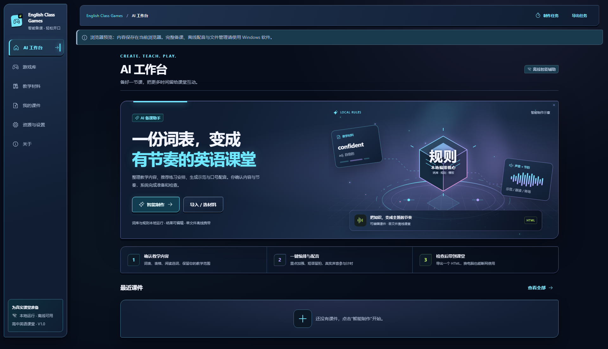
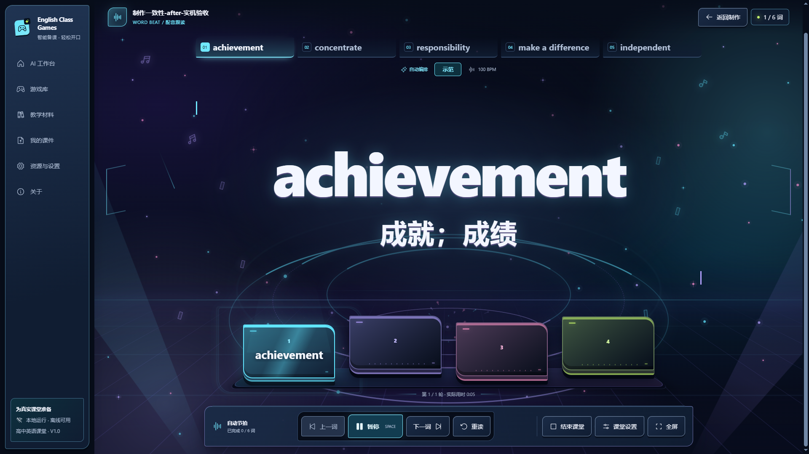

# English Class Games

### 本地智能备课，让英语课堂跟着节奏开口

**整理材料 → 确认教学内容 → 一键制作 → 预演 → 导出离线小游戏**

**[下载安装](#下载安装) · [快速开始](#快速开始) · [功能特性](#功能特性) · [使用手册](docs/10-最快导出小游戏-使用手册.md) · [更新日志](CHANGELOG.md)**

## 为什么使用它

面向高中英语教师的本地备课与离线课堂工具。首发游戏为 **单词节拍**，包含三种练习模式。

- **少做重复操作**：词表、表格、阅读选词都进入统一校对流程；词库候选、教师常用词、预设和已有声音可以复用。
- **安排有依据**：按真实音频时长和拍数计算编排，建议展示理由、影响范围和差异，保护手动值与锁定项，并可撤销。
- **到教室直接打开**：单文件 HTML 内嵌播放器、声音和必要许可，无需联网、安装备课软件或另装音色。
- **教师随时掌控**：课前和课中均可设置，支持逐词轮拍、临时词表管理、暂停、切词、重读与重玩。

这里的「智能」主要来自本地词库、规则、算法和真实状态检查；不把动画当成分析，不录制、识别或评分学生发音。内置神经配音是文本转语音，不是大语言模型。日常流程无需模型服务、账号或 API 密钥。

## 界面预览

## 下载安装

从 [GitHub 最新发行版](https://github.com/ahuiyuchuan/english-class-games/releases/latest) 下载 `English Class Games_1.0.0_x64-setup.exe`。**安装只需一个EXE**，其中包含必要运行资源、许可及源码获取说明；不用下载全部附件。

交付另含可直接打开的HTML示例、可编辑包、SHA256校验清单及源码包；教师日常上课只需携带导出的HTML。完整桌面源码从“关于 → 下载本版本完整源码”或同版发行页的Source.zip取得，无需账号；本地校验说明保留精确版本与摘要。HTML开始页可离线下载自身播放器源码。离线转交安装包时须同时携带同版本源码ZIP。

**系统要求**：备课软件面向 Windows 10 22H2 / Windows 11 x64；课堂 HTML 使用 Edge / Chrome 120 及以上版本。主要为 **1920×1080** 投屏设计，其他窗口保留基本兼容。当前不发布 macOS、Linux 或 Windows ARM64 安装包。

安装包尚未代码签名，Windows 可能显示未知发布者；请核对下载来源及 SHA-256。离线配音和 WebView2 增加了安装包体积，不需要教师预装 FFmpeg、Node.js、Rust 或开发工具。干净系统安装等实测边界见 [1.0.0 发行记录](docs/release-notes/v1.0.0.md)。

## 快速开始

1. 安装并打开软件，进入 **智能制作**。
2. 点 **使用示例词表 → 整理并预览**，检查英文和释义，点 **确认内容，下一步**。
3. 填课件名称、选练习模式，点 **一键制作**；配音模式使用内置中英声音，已有声音优先复用。
4. 点 **预演课件**，测试声音、开始课堂，检查单词和节奏。
5. 返回制作，点 **导出课堂文件 → 检查并导出**。需要继续编辑时，同时保存 `.ecglesson`。
6. 用 Edge / Chrome 打开实际导出的 HTML，再试一次；复制到教室电脑即可断网上课。

完整但简短的操作说明见 [最快导出小游戏](docs/10-最快导出小游戏-使用手册.md)。示例下载后先解压，再打开 HTML；`.ecglesson` 需在备课软件中导入。

## 功能特性

### 单词节拍的三种模式

| 模式         | 一轮的练习方式                   | 适用情况               |
| ------------ | -------------------------------- | ---------------------- |
| 配音跟读     | 软件示范 → 学生跟读              | 需要英文示范声音       |
| 文字领读     | 教师示范 → 学生跟读              | 教师带读、无需单词配音 |
| 学生自主齐读 | 学生直接跟随拍位朗读，无示范阶段 | 已熟悉内容的连续齐读   |

新课每词默认 **一轮**，已有课件、手动值和锁定项保持原安排。自主齐读默认每轮4拍、每次1拍，即读4次；每次2拍则读2次，仍是完整4拍。总拍数1～32、轮数1～8，非法组合会阻止保存与交付，不静默取整。

支持节奏方块／居中大词、自动／逐词推进。词块保留词语，并区分基础拍位与一次朗读开始；装饰效果不决定时间轴。暂停、后台、关闭特效或减少动态时停止装饰运动，必要文字反馈仍保留。

### 课前与课中的课堂设置

- 在 **课堂设置 → 练习安排** 搜索选词，调整轮数及当前模式适用的拍数；也可按明确范围统一修改，预览实际影响。
- 临时词表支持新增、删除、改词／释义、组内排序和撤销；配音不匹配会定位阻止保存，可明确改用文字领读。
- 所有设置统一点底部 **完成设置** 校验并保存到当前浏览器。重开、回到开始页和重玩会恢复成功保存的设置；原 HTML 和课件包不被改写。
- 换电脑、换浏览器、清理浏览器数据或移动本地文件可能无法沿用。需携带修改时，在编辑器修改并重新导出。
- 课中轮拍修改从下一词或重玩生效，当前词与重读保留已经开始的安排；增删排序后回开始页，按新词表重新开始。

**快捷键**：空格暂停／继续，左右方向键切词，`R` 重读。开始页可全屏，运行中可直接结束，无需打开设置。设置旁的说明按钮支持悬浮、键盘聚焦和点击。

### 声音、音乐与可视校准

- 内置中英双语离线配音，可选本机实际可用的 Windows 音色或导入录音。教师仍需试听多音词、缩写和教学读音。
- 音乐入口同时支持 MP3／WAV，以及本地 MP4 的 AAC-LC 音轨。视频最多500MB、音轨10分钟，输出 PCM16 WAV 最多50MB；有歧义的多音轨须选择。不上传素材，也不做人声分离。
- **普通伴奏**：音乐独立于课堂 BPM。**音乐对拍**：自主齐读按教师校准的恒速音乐运行。**音乐变速**：实际处理音乐速度，默认保留音高；原始100 BPM、目标120 BPM对应1.2倍。
- 提供波形、拍点、首拍、敲击测速和完整拍数循环建议。音乐能量不等于拍点；非恒速或不能稳定校准的音乐应使用普通伴奏。

详情见 [视频音轨导入](docs/06-本地视频BGM导入.md)、[自主齐读](docs/07-学生自主齐读.md) 和 [音乐变速与校准](docs/08-辅助能力与音乐变速.md)。

## 常见问题

**HTML 和课件包有什么区别？** HTML用于直接上课；`.ecglesson` 用于换机继续编辑。完整资料库备份是第三种用途，不用U盘直接承载正在编辑的数据库。

**为什么安装包仍较大？** 它保留真实离线配音模型、运行库、许可及WebView2离线安装器，确保断网安装和配音。完整桌面源码已改为独立附件，配音构建源码不再重复安装；程序只保留一份供断网导出的播放器源码。课堂HTML只携带本课需要的播放器、声音及播放器对应源码，不带配音模型。

**需要网络或大模型吗？** 安装、核心备课、配音、导出和离线课堂不需要。HTML内嵌播放器源码；完整桌面源码可提前下载后离线携带。关于页的完整源码下载、GitHub链接和手动检查更新需要网络，不上传教学内容、不自动下载安装。可选本地模型接口不是首发核心能力或课堂依赖。

**系统报告旧成果怎么办？** 制作结果按教学内容稳定比较，不把对象键顺序、保存时间或修订变化当成改课。确实改词、改名或改设置时会保留旧成果并提示重新制作，不能用旧结果覆盖新草稿。

## 开发与贡献

**技术栈**：Tauri 2 · Rust · React 18 · TypeScript · Vite · SQLite。

环境、资源恢复、检查及打包见 [CONTRIBUTING.md](CONTRIBUTING.md)；设计、行为与数据协议见 [设计总览](docs/english-class-games-详细设计.md)。发布流程见 [发版规范](docs/21-1.0.0发版与仓库规范.md)。

使用问题及反馈方式见 [SUPPORT.md](SUPPORT.md)。请先描述复现步骤、实际结果和期望结果，不上传学生个人信息、密钥或完整私人资料库。

## 许可与来源

项目自有代码采用 [GNU GPL v3](LICENSE)，SPDX：**GPL-3.0-only**，Copyright (c) 2026 ahui。允许商业使用、收费、修改及合规再分发；分发软件须履行GPL及第三方许可要求，没有“禁止商用”附加条款。此前已经合法授予的MIT权利不被追溯撤销。

Windows下载分发在同版发行页提供完整Source.zip，按GPLv3第6(d)条同等获取；物理介质转交时按第6(a)条同时携带该源码ZIP。每个新导出HTML仍内嵌播放器对应源码。源码包含原始代码、必要构建脚本、锁文件及相关第三方源码，不是source map或仓库主页链接。具体入口、版本摘要、构建与再分发说明见[许可证与对应源码](docs/22-许可证与对应源码.md)。

- ECDICT词库及原有口号模板保持MIT。
- 自有配音适配代码按GPL-3.0-only；sherpa核心Apache-2.0、链接的eSpeak代码GPL-3.0-or-later、Melo模型MIT等原声明保留，见[配音说明](resources/tts/NOTICE.txt)。
- SoundTouchJS 2.1.1保留MPL-2.0及对应原始源码；其他依赖见[前端许可](resources/THIRD-PARTY-NOTICES.txt)与[原生许可](resources/NATIVE-THIRD-PARTY-NOTICES.txt)。
- 教师词表、释义、录音、BGM和生成音频不会因使用软件自动变为GPL。公开版内置节奏音由项目合成，单独按CC0-1.0提供，来源与生成参数见[音乐说明](resources/music/README.txt)；播放器代码仍受软件许可约束。
