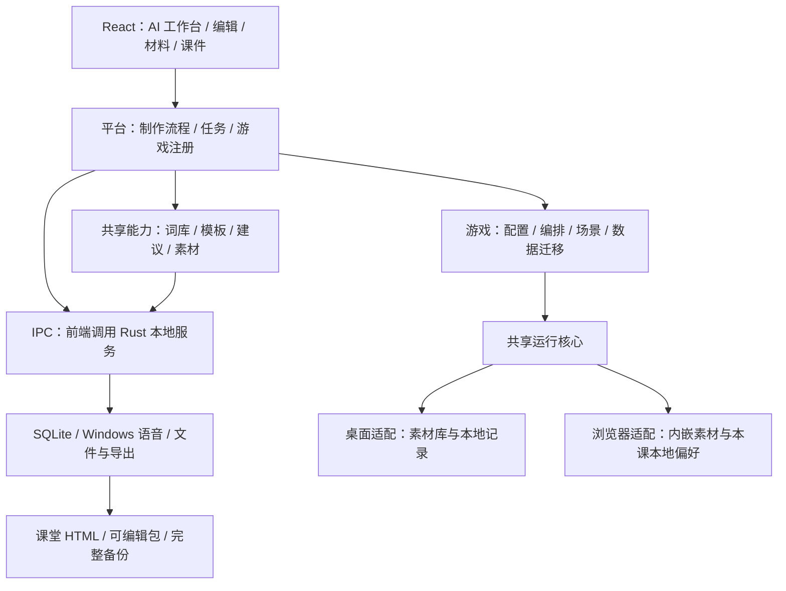

# 04 · 技术架构与数据规范

自主齐读扩展采用可选 `entry.chorus`（`beats`／`beatsPerRead` 均保留来源与锁定）、`chorusGapBeats` 和 `music.syncEnabled`／`music.sync`。旧字段和数据版本 1 保留，旧课件不变；自主齐读至少要求运行核心版本 2，含音乐倍率、保音高设置或不同原始／目标 BPM 的内容要求版本 3，旧核心拒绝导入／运行。此处是已有功能兼容边界，本轮不提升课件或运行协议。校准时间单位为毫秒，详见 [自主齐读规范](07-学生自主齐读.md) 与 [音乐变速规范](08-辅助能力与音乐变速.md)。回退使用旧课件快照和旧交付，不删除新字段硬退。

> V1.0 最终设计基线 · 作者：ahui · 2026-10-20 · [返回总览](english-class-games-详细设计.md)

## 1. 技术栈与职责

制作结果与当前草稿的一致性使用递归对象键稳定、数组保序的教学输入比较，不依赖JS与Rust序列化的字段排列；保存修订和时间不参与，真实声音与音乐参数及非法草稿仍完整受保护。初存、制作和终存的异步边界及结果页范围见 [制作成果一致性与过期保护](20-制作成果一致性与过期保护.md)。

Vite 只监听实际开发源码；`validation/`、`test-results/`、发行目录和 Rust 构建产物属于验证／生成输出，必须从热更新监听中排除。验证下载的临时锁定文件不应令开发服务崩溃，也不能将保护基线中的配置当成新的开发入口。

智能能力由本地处理链完成：**词库提供候选 → 规则给出建议 → 模板组合口号 → 制作或复用声音 → 编排器按真实时长安排节奏 → 检查器验证成品**；文字领读按教师示范拍数编排。这些能力服务于材料、制作、编辑和交付各页面；本地规则无需大模型；可选模型服务边界见08，离线配音也不承担文章理解或学生发音判断。

| 层         | 技术                                  | 负责                                                       | 不负责                                         |
| ---------- | ------------------------------------- | ---------------------------------------------------------- | ---------------------------------------------- |
| 桌面容器   | Tauri 2 / WebView2                    | 窗口、权限、本地调用与安装包                               | 游戏规则和远程服务                             |
| 前端       | React 18 / TypeScript / Vite          | 页面、编辑、预演、课堂及离线播放器构建                     | 直接操作数据库或任意本机文件                   |
| 组件与样式 | Tailwind CSS 3 / Radix UI / Phosphor  | [统一视觉与交互](02-页面交互与视觉规范.md)                 | 为各游戏复制独立组件库                         |
| 游戏表现   | Canvas 2D / 内联 SVG / CSS 透视与动画 | 星尘、光轨、击拍爆发、立体装置与操作反馈                   | WebGL 运行前提、在线特效服务或另一套教学时钟   |
| 数据状态   | TanStack Query 5 + 局部状态           | 持久化请求、任务查询；当前对象与播放状态局部管理           | 把音频调度时钟放入全局页面状态                 |
| 智能规则   | TypeScript 纯规则与词库索引           | 词库批量匹配、内容候选处理、游戏编排、建议与复现           | 网络推理、任意代码执行                         |
| 本地服务   | Rust / Serde / Windows API            | 受控材料文件读取、系统语音、资源、数据库、任务、打包与校验 | 重复实现前端词库匹配或单词节拍规则             |
| 存储       | SQLite / rusqlite / 素材目录          | 课件修订、来源、任务、索引与不可变声音文件                 | 把整个音频库塞进一个数据库字段                 |
| 运行       | 游戏模块 + 共享运行核心 / Web Audio   | 桌面与 HTML 共用编排解释、时钟与音频控制                   | 课堂实时重新生成声音                           |
| 工程       | mise / pnpm / Cargo / 锁文件          | 固定工具链与依赖，UTF-8 无 BOM、LF                         | 增加 Java、HTTP 后端、数据库服务器或大模型 SDK |

采用界面、原生服务和本地存储分层；Phosphor 图标、智能规则、系统配音和便携课件属于本项目选型与设计。支持 Windows 10 22H2 / Windows 11 x64，不承诺更早的 Windows 10 构建。依赖补丁版本由工程锁文件固定；升级需通过本组验收，不随构建自动漂移。项目级工具版本由 mise 管理，Rust 工具链固定于 `rust-toolchain.toml`。

### 1.1 模块关系

### 1.2 模块职责与代码位置

| 位置                                                                           | 职责边界                                                               |
| ------------------------------------------------------------------------------ | ---------------------------------------------------------------------- |
| `src/app`、`src/platform`                                                      | 页面入口；材料、课件、任务和游戏注册等平台流程                         |
| `src/games/word-beat`                                                          | 首版游戏的数据结构、规则、建议、编排、编辑和课堂场景                   |
| `src/runtime`、`src/portable`                                                  | 共用运行控制与桌面 / 离线 HTML 环境适配                                |
| `src/shared/ai`、`src/shared/schemas`                                          | 可复现的共用智能辅助、结果摘要及数据结构校验；不放单词节拍专属规则     |
| `src/shared/ui`、`src/shared/styles`                                           | 跨页面复用的交互组件和设计变量                                         |
| `src/shared/effects`                                                           | 通用 Canvas 能量场与运动环境订阅，只消费外部事件，不读写课件或推进教学 |
| `src-tauri/src/lib.rs`、`src-tauri/src/commands.rs`                            | Tauri 启动、命令注册、前端 IPC 与参数入口                              |
| `src-tauri/src/model.rs`、`src-tauri/src/error.rs`                             | IPC 数据结构与稳定错误封装                                             |
| `src-tauri/src/database.rs`                                                    | SQLite 数据访问、事务、版本迁移、快照和一致性备份                      |
| `src-tauri/src/assets.rs`、`src-tauri/src/speech.rs`、`src-tauri/src/files.rs` | 音频素材、Windows 系统语音、受控文件访问与导出                         |
| `src-tauri/src/packages.rs`、`src-tauri/src/backups.rs`                        | 可编辑课件包、完整备份及恢复                                           |
| `resources/dictionary`、`resources/slogan-templates.json`                      | 内置词库数据、口号模板及各自的来源 / 许可说明                          |

舞台由 `ClassroomVisuals.tsx`、`StagePortal.tsx` 与共享 `GameParticleField.tsx` 组成：游戏负责关卡装置、词语、四色拍垫和真实阶段映射，共享效果只负责 Canvas 星尘连线、拖尾、有限火花和冲击环。备课全息编排示意使用内联 SVG / CSS，不借装饰推断任务进度。桌面与便携课堂使用同一实现，编辑器传入静态参数；不引入第三方特效依赖或网络资源。

准备倒数、拍垫与爆发事件读取当前阶段和真实拍序。Canvas 的 `requestAnimationFrame` 仅绘图，不成为教学时间来源，不播放声音、不改编排、不按动画完成事件推进。开始页允许低速氛围，运行按外部拍序触发；暂停、等待、隐藏页面、特效关闭或减少动态效果时保留静态画面并停止绘制，退出时取消循环、尺寸观察和指针 / 环境订阅。Canvas 上下文不可用时保留 CSS 骨架、教学内容和控制。

效果预算有明确上限：最多 72 枚星尘、96 枚短命火花、4 个冲击环和 2 道流星，连线只检查固定候选并封顶 22 条；绘制最高 45 FPS，设备像素比上限 1.5，画布约 220 万物理像素封顶。跳帧不影响教学进度，指针交互只轻推附近星尘，不拦截输入。“舞台特效”随本课课堂设置在浏览器本地保存，不增加课件字段或数据库迁移；系统减少动态偏好优先，具体恢复与兼容按文档15执行。颜色来自共享语义色与游戏装饰变量，动效遵循统一的启停规则。

共享视觉只维护一套来源：`tokens.css` 定义深墨蓝 / 青色亮边行动 / 青色智能与组件别名，公共样式管理按钮、输入、导航、卡片、列表和浮层；制作与课堂样式只补充布局和场景部件，不覆盖另一套品牌语义。课堂设置沿用 Radix 的焦点管理与原生表单语义，悬浮播放控制台仍调用同一运行核心。拍垫跑道、刻度、局部扫光、电弧和厚底使用内联 SVG、CSS 与现有 Canvas；不为这次视觉重构增加游戏引擎或特效包。

视觉变更不修改课件协议、数据库版本、编排算法和教学时钟。桌面、静态预览和导出 HTML 共用场景组件；静态预览不运行动画和声音。修改样式或表现后，先构建便携核心，再生成示例，核对桌面与 HTML 的内嵌脚本和样式身份，避免新桌面配旧课件。设计文档先确定，再实现，再按同一规格复核全页面，验证报告单独记录实际结果。

## 2. 本地智能处理链

1. Rust 受控读取材料文件，校验大小 / 编码 / 访问范围并解析为工作表或文本行；TypeScript 根据教师选列整理条目，基于随应用分发的词库建立索引，批量完成匹配、候选分组和优先级，再交教师确认；不对每行重复全表扫描，也不在 Rust 维护另一套词库匹配引擎。功能词清单与词库一起分发，整理结果同时记录词库、功能词清单与匹配规则版本；短语匹配边界按 01 §2.1 执行。
2. 教师确认后固定材料修订，平台调用当前游戏的准备入口，产生草稿、建议与声音需求。从材料详情进入时，先按界面规则完成材料保存，再交接所选内容副本。
3. Rust 先查声音缓存，再在后台逐项合成或验证录音；保存真实格式与时长。界面接收阶段事件，不阻塞编辑。
4. 游戏编排入口基于固定输入、规则 / 模板版本和实际声音元信息生成最终安排，通用检查器叠加游戏字段检查与素材检查。
5. 预演、开始课堂和课堂 HTML 导出默认固定当前草稿并检查；全部必需项成功后将其保存为已准备修订，再引用该修订执行。失败先修复，仅教师明确选择才可使用旧已准备修订，不能混用不同草稿的声音和时间安排。可编辑包另按 §5 检查固定快照，不要求教学草稿已可运行。

候选补全、预设、时间优化与改编细则仅定义于 [AI 教学规则](01-AI赋能与教学规则.md)。材料页、工作台和课件改编复用同一制作入口；编辑器复用同一建议、声音依赖和检查服务。所有智能入口采用以下公共结果约定，避免不同页面或游戏各自解释“智能成果”。

| 结果信息   | 必须遵守的约定                                                                                                                                                                                   |
| ---------- | ------------------------------------------------------------------------------------------------------------------------------------------------------------------------------------------------ |
| 输入与版本 | 标明本次处理的材料 / 课件版本；尚未保存的输入使用本次输入标记，迟到结果不能替换新输入                                                                                                            |
| 依据与来源 | 记录实际触发的 `ruleId`、规则版本或候选来源；无命中如实返回，不编造理由                                                                                                                          |
| 候选与影响 | 给出作用对象、依赖和候选；超出本次已确认范围的结果不写入教学内容，已有内容的修改先预览后接受，并列出前后值与保留项                                                                               |
| 状态与数量 | 结果的推荐 / 接受状态与任务的处理 / 完成状态分别记录；阶段遵循 [任务顺序](01-AI赋能与教学规则.md#4-任务与失败边界)，最终编排在真实声音时长就绪后执行；只提供实际可统计的数量，未知时不填虚假进度 |
| 下一动作   | 按结果提供接受、应用、忽略、定位、修复或重试；没有可执行动作时说明原因                                                                                                                           |

数量和时长等游戏摘要可省略，不强制所有游戏返回词数、BPM 或学习成绩。桌面保留依据供回查，课堂成品只携带已确认的运行内容，不显示制作中的候选或建议。

必须保存输入修订、依赖字段及值的摘要，应用时同时校验当前修订和依赖。无关编辑后可在依赖未变的前提下更新到当前修订再提交；依赖已变则失效，重新检查后生成建议。整次应用在单一保存操作中完成，防止旧差异部分写入。词表与音色变化只失效受影响声音，节奏与轮数变化只重编排，依赖占位符的口号随课件名 / 词数更新，不触发无关声音重做。

模板先按编号稳定排序，使用保存的非零 32 位整数作为随机标记，V1 采用 xorshift32 伪随机序列与 Fisher–Yates 段内洗牌；仅对允许变化的位置操作。算法变动必须更新规则版本；测试使用固定输入、声音时长和随机标记验证结果。系统语音再次合成可能产生不同声音时长，复现教学安排以保存的音频和其元信息为准。

### 2.1 语音与任务

默认新课使用随安装包分发的离线神经音色，由 `builtin_speech.rs` 启动隔离工作进程并复用原声音任务、缓存和素材链。引擎／模型标识加入缓存环境键，失败、取消及超时清理子进程和临时 WAV。组件、资源校验、许可和兼容约定见09。

可选系统音色仍由 Rust 通过 Windows WinRT `SpeechSynthesizer` 枚举 `AllVoices`，使用 `SynthesizeTextToStreamAsync` 制作声音，使用接口支持的语速选项；在后台线程初始化所需系统调用环境。只列出接口实际可合成的音色，不把操作系统设置中的任意名称当作可用音色。产物转换或保存为浏览器可解码的 PCM WAV，并记录真实时长。

系统配音缓存键包含规范化文本、语言、音色标识、语速、系统语音环境标记及生成器版本；已有音频内容以 SHA-256 标识。语音文本只统一首尾和重复空白，不转小写、不做词形归一、不去掉连字符或撇号，避免 `US` 与 `us` 错用同一声音。改节奏不重新配音，改文本 / 合成设置则按依赖失效；恢复相同文本可复用匹配声音。

口号以展开并校验后的最终文本参与声音匹配与缓存；原文本中的占位符只用于编辑和依赖追踪，不作为实际朗读内容。

声音引用区分“合成配音 / 导入录音”（既有 `source: system` 协议值继续表示合成配音，包含内置及系统音色，不迁移历史数据）。录音关联教师确认的文本匹配标记，文本改变仍失效，但不受系统音色 / 语速设置影响；复用依靠明确的素材引用，不按文件同名或英文相同任意匹配其他录音。改为合成配音须明确操作并显示替换范围。

语音默认串行，每项 30 秒超时，可取消；取消或超时后丢弃该项迟到结果，不继续写入当前任务引用。缓存命中的声音计入真实完成数量。重试只处理失败 / 失效项；导入与导出在后台执行，默认各一个任务，避免同时解码和打包造成内存峰值。

### 2.2 智能规则目录

`ruleId` 标识稳定的规则类别；版本独立保存并绑定课件修订，不放进编号。平台规则可供所有游戏复用，游戏规则以 `gameId` 为前缀。编号退役后不复用；记录仍保留当时的依据、对象和前后值，教师界面使用教学用语。

| 规则编号                     | 职责                                   | 业务依据         |
| ---------------------------- | -------------------------------------- | ---------------- |
| `platform.material.match`    | 原文位置、最长短语、词形与疑似重复候选 | 01 §2.1          |
| `platform.meaning.candidate` | 教师内容优先、词义来源与可接受候选     | 01 §2.1～2.2     |
| `word-beat.preset`           | 预设、重点及单词 / 短语的默认参数      | 01 §3.2          |
| `word-beat.duration`         | 超目标时的建议顺序和手动 / 锁定保护    | 01 §3.3          |
| `word-beat.slogan`           | 口号用途、启用范围与占位符             | 01 §3.4          |
| `word-beat.variant`          | 允许变化范围与可重复选择               | 01 §3.5          |
| `platform.audio.dependency`  | 声音匹配、失效与有效缓存复用           | 01 §3.4，04 §2.1 |
| `platform.delivery.check`    | 当前模式所需资源与成品完整性           | 03 §4，04 §4～5  |

同类问题可生成多条记录，具体原因和差异来自本次实际输入；目录不代替字段与素材校验。规则版本升级与兼容按 §5 执行，不以更换说明文案偷偷改变旧课件的教学安排。

## 3. 多游戏接口与运行边界

游戏为随应用构建的内置模块，不下载执行第三方脚本。平台根据能力显示编辑和课堂动作，不按 `word-beat` 名称写例外判断。

| 接口部分       | 必需声明或行为                                                                                                                                                                |
| -------------- | ----------------------------------------------------------------------------------------------------------------------------------------------------------------------------- |
| 描述           | 稳定 `gameId`、模块版本、数据版本、最低平台版本、支持材料类型                                                                                                                 |
| 列表摘要与结果 | 游戏提供可展示的摘要和带类型结果；不适用的数量 / 时长可省略，平台不直接读取段落、BPM 或词表字段                                                                               |
| 配置与校验     | 默认配置、可保存的新课默认项、编辑组件、建议说明；分别提供未知输入的结构 / 版本校验和教学内容的运行校验，不能靠类型断言接纳导入对象；游戏自行定义玩法参数                     |
| 准备与编排     | 输入材料副本、设置与规则上下文；返回草稿 / 声音需求；取得素材时长后返回可运行数据                                                                                             |
| 复制与内部身份 | 平台生成课件新身份，游戏模块通过共享映射上下文重建内部对象身份；两份修订中的同一对象保持对应。替换材料走游戏准备入口，平台不解析段落、词条等游戏字段                          |
| 素材使用声明   | 分别声明全部持久引用、当前模式启用引用及使用用途；示范 / 口号按语音解码，音乐按媒体播放。素材来源不等于使用用途，同一素材作多种用途时须分别满足要求，平台不解析游戏字段猜用途 |
| 运行           | 创建、开始、暂停、继续、结束、销毁；支持的扩展动作另行声明                                                                                                                    |
| 能力           | 预演、单文件导出、切条目、重读、调速、展示切换、结果类型等能力标记                                                                                                            |
| 迁移           | 从已支持旧数据版本迁移到当前结构，保留原件，失败不入库                                                                                                                        |
| 导出           | 可内嵌运行入口、引用素材清单和浏览器适配需求                                                                                                                                  |

身份重建覆盖模块明确声明的全部内部对象及引用；单词节拍包括段落、词条、口号与建议，同时更新内部引用、未完成编辑输入的对象定位和字段键。草稿与已准备修订共用一次映射，两版中仅一版仍保留的对象也须重建；教学文本、原文和来源说明即使恰好与旧标识相同也不得替换，不能采用全局字符串替换。

平台的材料整理、声音和任务能力供所有游戏使用，练习编排由具体游戏提供。时间轴、BPM、轮数、正确率均不是平台必填字段；平台结果只保留游戏专属的带类型数据。首版只注册单词节拍，测试用最小接口数据检查通用性，不实现第二个游戏。

新课默认项按 `gameId` 分开保存并交给对应模块校验；单词节拍的预设、目标时长和展示模式不作为其他游戏的必填设置。公共界面按模块声明显示适用字段和动作，材料不受支持时解释原因，不强行转换成词表。

共享运行核心不能直接依赖 Tauri、SQLite、系统配音或绝对路径。桌面适配层从受管理素材库取数据、保存运行记录；浏览器适配层从课堂文件取素材，仅保留本次会话。两端共用游戏场景、时钟、动作语义和校验规则。

HTML 构建为自包含脚本与样式，素材内嵌后转为内存资源：语音按 [声音与资源规范](03-课堂运行与便携交付.md#3-声音与资源)滑动解码，背景音乐通过媒体元素按需播放并接入同一混音控制；不依赖 `file://` 下的跨文件请求、模块导入或本地服务。教学文本按文本节点显示，课件数据安全编码嵌入，避免 `</script>` 等内容逃出数据区；不使用用户内容生成可执行脚本或任意 HTML。

## 4. 数据、保存与一致性

### 4.1 主要数据对象

| 对象         | 关键字段与约束                                                                                                                                                                                                                                                   |
| ------------ | ---------------------------------------------------------------------------------------------------------------------------------------------------------------------------------------------------------------------------------------------------------------- |
| 材料集与条目 | `id`、修订号、原文 / 位置、英文、义项、词性、单元、重点、标签与教师确认状态；材料来源和义项来源分别记录，后者含词库名称 / 版本、原候选及其校对状态快照、教师修订标记；记录由接受候选实际补空的字段，不从非空值反推；课件保存来源与内容快照                       |
| 教师常用词   | `id`、保留大小写的英文、检索规范文本、义项、词性、重点、标签、来源和修改时间；仅显式保存 / 更新，不自动学习                                                                                                                                                      |
| 制作偏好     | 按 `gameId` 保存教师主动设置的新课默认值，单词节拍的字段范围及初始值见 [制作默认规则](01-AI赋能与教学规则.md#31-三步完成)；创建时复制进课件，不建立实时联动。没有已保存偏好的新课使用自动推进与节奏方块；已有课件及主动保存的逐词 / 居中偏好保留原值，不隐式迁移 |
| 课件         | `id`、名称、`gameId`、数据版本、草稿修订、最近已准备修订、来源课件标识、创建 / 修改时间                                                                                                                                                                          |
| 课件修订     | 不可变修订号、材料副本、游戏数据、未完成编辑输入及问题、声音模式、配置来源、锁定项、规则 / 模板版本、随机标记、检查结果                                                                                                                                          |
| 单词节拍数据 | 段落与条目顺序、条目标识、英文 / 释义、`entryType` 单词 / 短语及来源、轮数及来源、文字示范拍数、跟读模式与手动拍数、课级默认及条目声音覆盖值 / 继承标记、声音引用、口号文本与启用状态及各自来源 / 锁定、所用模板及最终编排                                       |
| 素材         | `assetId`、SHA-256、媒体类型、字节数、相对位置、时长、采样率 / 声道数及解码预算用量、声音来源、生成参数及文本匹配标记                                                                                                                                            |
| 建议         | 输入修订、`ruleId`、作用对象、依赖字段与值摘要、原因、前后值、可应用 / 已应用 / 已忽略 / 需重新检查                                                                                                                                                              |
| 任务         | `taskId`、类型、课件 / 输入修订、独立输入快照及素材引用、阶段、状态、完成 / 总数、产物、失败项、取消标记与重试来源                                                                                                                                               |
| 导出         | 源课件 / 修订、游戏与运行核心版本、声音模式、导出时间、资源清单和成品校验值                                                                                                                                                                                      |
| 运行记录     | 课件修订、起止时间、实际时长、教师动作与游戏专属结果；不保存学生个人数据                                                                                                                                                                                         |

新业务标识使用 UUID，修订号为课件内从 1 开始递增的正整数。持久化时间使用 UTC ISO 8601，界面按当前电脑本地时间显示；时长统一毫秒、BPM 统一每分钟拍数、音量统一 0～1、文件大小单位 MB 按 1,000,000 字节计算，字符上限按 Unicode 码点计数。JSON 使用 camelCase，数据库列使用 snake_case，通过明确映射转换。

中文释义为空表示不显示，不用虚构默认义项；空词性 / 标签为未提供。教师已确认的空释义不再自动补回。未提供手动值时才采用规则默认，`0` 不当作未提供；非法数值不自动夹到合法范围。准备、运行和课堂 HTML 导出要求必需字段完整合法；未知的更高数据版本拒绝写入。

草稿结构与业务校验分开：结构、版本、资源引用和安全限制仍严格检查；未完成的教学输入以字段原始值及错误位置保存，不写入可运行数据。可运行数据保留最近合法值或为空，准备入口必须检查当前原始输入，不能用旧合法值绕过错误。可编辑包同样保留这些输入，允许继续编辑，不将其标为可上课。

草稿引用须符合素材标识和归属约束；已登记文件后来丢失 / 损坏时记录为待修复问题，仍允许保存教师的新编辑。准备、运行和课堂 HTML 只检查当前声音模式启用的资源；可编辑包导入与导出检查两份快照全部声明或引用的素材，不能以允许保存草稿绕过缺损。

材料与常用词通过快照进入课件，修改或删除来源不级联改变课件修订；来源已删仍保留原来源说明和内容。候选校对状态随接受、保存常用词、复制和导包保留，不从教师确认或词库名称反推；历史缺失值保留为未知，不默认已校对。常用词按保留大小写并整理空白后的英文、词性、义项定位同一义项，再比较重点 / 标签：全部相同才跳过，教学字段变化须明确更新；其他同英文义项进入冲突预览，不以检索键唯一约束丢掉多义项。

材料条目的 `source.analysis` 保存本次整理依据：固定 `ruleId=platform.material.match`、正安全整数 `ruleVersion` / `functionWordsVersion`，以及各词库的非空 `name` / `version`；未使用词库时版本列表为空。教师常用词快照的版本记为 `teacher`，不把它冒充基础词库版本。旧材料可无此字段；存在时须完整合法，复制、导包和备份原样保留，包括未来正整数的历史规则版本，不据此重算或补造旧来源。

普通复制由平台重建课件身份、游戏模块按 §3 重建全部内部对象及引用，记录来源课件 / 修订，保留手动值和锁定，声音继续引用不可变素材。“替换材料”按 [换课复用规则](01-AI赋能与教学规则.md#36-复制课件与换课复用)重新准备新条目，不用英文相似或位置相同推断旧手动值应继承；声音只按实际匹配键复用。

副本在教师确认后创建，课件身份、所需修订快照与素材引用在同一事务中写入，失败不留下半份课件；创建前后的取消边界按 [页面交互](02-页面交互与视觉规范.md#1-视觉方向与公共布局)执行。未准备过的课件不补造已准备修订，相同修订共用一份快照。

保存冲突后的“另存本地副本”使用当前本地草稿及其仍保留的已准备快照，包含未完成输入和会话素材引用，按同一身份重建与事务规则保存；不能重新读取已保存草稿来代替教师的本地修改。另存不覆盖冲突课件，失败保留会话与输入。

新副本的当前草稿使用教师填写的名称；独立保留的旧已准备快照沿用原名称，保证依赖 `{{lessonName}}` 的口号与声音仍与当时内容匹配。新草稿只使实际依赖新名称的声音失效，其他匹配声音继续复用。

跟读模式区分按预设公式计算和手动固定拍数；保存公式模式及当前结果，不只保存一个最终数值。改 BPM、预设或声音时只重算自动值，保护手动值；文字示范拍数也独立保存，换机不恢复成默认。

口号文本来源 `textSource` 与启用来源 `enabledSource` 分开保存。旧版缺少来源字段时保持可读，不推断启用开关仍可由智能建议关闭；文本仅在原模板及语言完全匹配时视为模板内容。教师明确修改后保留手动来源，即使又改回模板原句也不自动交回规则管理；主动接受新模板后记录新模板来源。新增字段为可选扩展，不改旧课件内容，回退仍以完整备份恢复。

### 4.2 草稿、素材与备份

草稿保存带 `expectedRevision`，与当前修订不一致则返回冲突并保留输入，不用旧请求覆盖新编辑。停止编辑后的自动保存时间以[界面规范](02-页面交互与视觉规范.md#33-状态与反馈)为准；已准备修订只在全部检查通过后推进，草稿保存成功不代表可上课。

固定保留当前草稿、最近已准备修订，以及仍被任务、导出、备份或运行引用的快照。尚未落盘的编辑内容先建立会话素材引用，保存成功后由修订接管；撤销 / 重做引用保留到记录淘汰或会话结束。其他自动保存修订在无引用后可回收，不因每次自动保存永久保留整段历史和旧声音。删除课件先释放其持久引用，仍被其他课件或活动快照使用的素材继续保留。

数据位于用户本地应用数据目录下的 `english-class-games`：数据库、不可变 `assets`、任务暂存、导出副本与备份分目录。SQLite 开启外键与 WAL；资源先写临时文件并校验，再移入正式目录，引用记录在同一数据库事务中全部成功或全部回滚。进程中断可能留下无引用资源，启动恢复清理，不删除其他课件仍引用的声音。

任务状态为排队、运行中、已完成、部分失败、失败、取消请求中、已取消、已中断；终态不接受迟到结果改写。输入与当前草稿修订不一致时，任务成果只保存为原修订候选，不能直接应用到新草稿；界面只读查看旧成果，或对当前修订重新制作并复用匹配声音，不提供隐式合并。

创建制作任务时，在同一事务中保存实际输入修订的独立快照和全部素材引用；不只存源课件的修订号。该快照不随源课件删除或自动保存回收，清除终态任务才释放；完整备份包含这些任务输入。历史任务若缺少独立快照，仅可读取实际仍保留的原修订，无法取得时说明原输入不可恢复，不用当前草稿或同名课件冒充。

导出排队时立即分别固定所选课堂修订与可编辑包所需快照，通过进程内独立所有者写入 `session_inputs` 并保留素材引用；不能等排到队首才读当前课件。Rust 根据所有者读取已固定的输入并重新校验，不依赖之后变化的已准备指针；源课件继续保存、重新准备、删除或清缓存都不能替换该次输入。各文件独立记录成功 / 失败，一项固定失败不掩盖另一项已成功的成品。任务结束释放这组临时输入；启动与恢复清理旧进程记录，完整备份不包含 `session_inputs`。

相同课件 / 输入 / 类型仍有排队、运行中或取消请求中的任务时，重复提交复用该任务标识；终态任务不重新打开。部分失败、失败、取消或中断后明确重试，创建关联原任务的新标识，继续复用匹配产物，已成功声音不重复制作。

终态任务的未应用产物由该任务保留；教师清除终态记录后释放这组候选引用，随后才可被缓存清理回收。已保存修订独立引用已采用的素材，不随任务记录删除；清除进行中任务须拒绝，取消完成后才允许清除。

备份使用 SQLite 一致性备份接口，枚举备份数据库全部已登记素材（含独立资源库）并校验后打包，不能只复制正在写入的数据库文件。固定导出 / 备份快照时同时保留内容和全部所需素材，临时引用独立于源课件的级联删除关系，直到任务结束才释放，避免期间删课件或清缓存使素材消失。启动时释放上次进程的运行、导出、备份及编辑会话临时引用；配音任务即使已中断，其成功产物仍由终态任务保留，直到清除记录。

缓存清理仅处理无有效修订引用且不被运行 / 任务 / 快照 / 编辑会话使用的文件。教师主动保存在资源库的录音 / 音乐具有独立持久引用，尚未用于课件也不能当缓存删除；明确从资源库删除后才释放这项引用，其他课件引用继续有效。

完整备份含课件与保留修订、材料集、常用词、偏好、任务与导出记录，以及备份数据库中全部已登记素材文件；不包含可重新生成的临时文件或导出成品副本。独立备份清单记录备份格式 / 数据库版本、文件路径、大小和 SHA-256，不使用单课包格式。V1 上限为压缩包 5,000 MB、解压总量 10,000 MB、100,000 项、清单 20 MB；流式打包 / 解压并持续检查实际预算，路径安全规则与课件包一致，超限或空间不足不切换现有数据。恢复后原活动任务标为已中断，不自动重启配音或写文件。

恢复和迁移先完成当前草稿保存，再阻止新写入，等待或取消现有写任务并确认停止，完成当前完整备份；保存或备份失败则停止切换。暂存验证成功、旧数据库连接关闭后整体切换，再恢复服务；成功后关闭旧编辑 / 预演会话、清空撤销和查询缓存并重新载入。进程启动及成功切换后生成新的数据库代次 `dataEpoch`，不从备份继承；旧代次的写请求返回 `DATA_REPLACED`，即使对象和修订号碰巧相同也不接纳。失败继续使用原数据及原代次，保留原输入，旧连接不得在成功切换后继续写入。

导出本机副本不随失败清理删除；“清理导出副本”需显示数量与大小并由教师选择，不影响课件素材和已经复制到 U 盘的文件。课件包不包含整个个人数据库。

导出结果历史采用 `version:1`，保存源课件 / 修订、各文件状态、本机副本 / 已选择目标路径、字节数、SHA-256 与错误；串行落盘，记录失败不能将实际文件成功改写为失败。未知更高版本或损坏记录保留原值并显示修复 / 重试入口，不覆盖为空历史。重启后的进行中结果标为已中断，不自动续导；终态历史仅保留结果，不保留活动输入。旧外部目标不再视为已验证，界面明确提供本机副本检查和按原哈希重新复制；本机副本不存在或已变更时，须重新选版导出，不能用当前课件冒充原成品。备份保留历史记录，导出成品文件由教师另行携带。

### 4.3 本地调用与错误

前端与 Rust 的调用按操作需要携带请求标识、对象标识、输入修订与参数：保存 / 准备课件须提供对应修订，枚举音色不需要课件修订，重新复制成品使用成品标识与校验值。启动读取服务状态取得 `dataEpoch`，所有写请求携带该代次，后端先校验代次，再校验该操作适用的修订或成品。响应包含成功数据或错误码、可读消息、字段 / 对象位置、能否重试。任务事件只传任务标识、阶段、计数和错误定位，不在日志反复输出完整教学材料。

| 错误类别                                | 稳定含义与处理                                                                                                                                        |
| --------------------------------------- | ----------------------------------------------------------------------------------------------------------------------------------------------------- |
| `VALIDATION_ERROR`                      | 字段 / 格式 / 范围不合法，回到具体输入修正                                                                                                            |
| `REVISION_CONFLICT`                     | 已保存版本已变化，保留本地输入；编辑器按 [冲突交互](02-页面交互与视觉规范.md#33-状态与反馈)查看、另存独立副本或确认后重新载入，不用更新修订号直接覆盖 |
| `VOICE_UNAVAILABLE`、`SYNTHESIS_FAILED` | 音色不可用或单项配音失败，修复 / 导入 / 重试                                                                                                          |
| `ASSET_MISSING`、`ASSET_INVALID`        | 素材缺失、损坏、声音不匹配或不可解码                                                                                                                  |
| `TASK_INPUT_UNAVAILABLE`                | 旧任务没有可用的输入快照，且对应原修订已不可恢复；保留任务与可独立试听的声音成果，不用当前课件代替原输入                                              |
| `EXPORT_INPUT_UNAVAILABLE`              | 本次导出的独立输入快照不可用或与所选修订不符；该文件停止导出，保留其他文件结果，重新选版后发起新导出                                                  |
| `UNSUPPORTED_VERSION`                   | 包 / 游戏版本超出当前支持，不写入                                                                                                                     |
| `FILE_ACCESS_ERROR`                     | 路径不可访问、权限不足或介质不可用等文件读写失败；说明失败阶段，保留源文件和已有目标，提供另存或重试                                                  |
| `SPACE_INSUFFICIENT`                    | 打包或写入所需空间超过可用空间；保留已有目标，清理未完成临时文件，保留已生成的本机副本，并允许选择其他位置或释放空间后重试                            |
| `DATABASE_ERROR`                        | 本地数据库读写或迁移失败；保留教师输入，显示重试或恢复入口                                                                                            |
| `INTERNAL_ERROR`                        | 未分类的后台操作失败；不显示内部堆栈，保留输入并允许安全重试                                                                                          |
| `MAINTENANCE`                           | 恢复或维护正在进行，拒绝冲突写入；完成后刷新数据再继续                                                                                                |
| `DATA_REPLACED`                         | 备份恢复已切换数据代次，旧页面写入被拒绝；重新载入后再操作                                                                                            |
| `UNSUPPORTED_PLATFORM`                  | 当前平台不支持该本地操作；说明 Windows 10 / 11 的受支持范围                                                                                           |
| `CANCELLED`                             | 主动取消，不当作系统崩溃或成功完成                                                                                                                    |

Rust 对所有输入和路径重新校验，不只信任前端。文件权限限定于用户明确选择的位置及受管理目录；导入内容不扩展应用权限，课堂播放器不获得任意本机文件访问权。

主窗口在标准核心权限外启用 `core:window:allow-destroy`，供未保存确认和写盘完成后关闭窗口。导入、复制等文件操作进行中阻止关闭；等待确认或保存后再次检查文件操作状态。教师取消或保存失败时保留窗口及输入。

## 5. 可编辑包格式与兼容

V1 包包含 `manifest.json`、`lesson.json`、`assets/` 与必要归属文件。清单记录 `formatVersion`、`gameId`、最低平台版本、运行核心兼容要求、源课件、生成时间、`lesson.json` 文件 SHA-256，以及各资源的相对路径、类型、大小、时长和 SHA-256。准备状态按导入检查重新计算，不相信包内一个“已完成”标记。

`lesson.json` 保存必填的 `draftRevision`、可空的 `preparedRevision` 指针及对应的 1～2 份完整修订快照；修订号均须为正整数，已准备修订不得大于草稿修订，指针必须对应包内实际快照，两者相同时共用一份。各快照分别保留游戏数据版本、声音模式、配置、来源与检查结果，素材取两版实际引用的并集。导入副本时平台与游戏模块按 §3 重映射课件、全部内部对象及引用，保留两版中同一对象的对应关系及原来源。

只有来源课件 / 修订身份、实际 `lesson.json` 文件 SHA-256 和素材哈希清单均与既有导入记录相同，才可打开已有内容；不能只凭 ID 或清单自报摘要判重。身份相同但内容不同走冲突并导入副本，不覆盖已有版本。兼容检查同时覆盖包格式、最低平台、两份快照的游戏数据及规则版本、运行核心要求。

复用还须定位仍保留且实际内容与本包一致的目标修订；若目标已继续编辑，不能把不同内容的当前草稿当作重复包打开。只有历史导入记录相同、对应修订已回收或无法验证一致时，重新导入副本。两份快照分别执行结构、数据版本、规则兼容和素材引用校验，任一失败均整包拒绝。

草稿中未生成声音不绑定素材；失效声音可保留校验通过的旧素材引用，但显式标为失效，不能当作当前声音运行。任何素材引用都必须列入清单、实际打包并校验。源课件已引用文件缺失或损坏时，可编辑包导出也定位阻止，不能漏写清单绕过校验。

缺损仅属于当前草稿时，可修复素材，或由教师明确取消引用并保存新修订；最近已准备修订仍引用该缺损素材时，须修复素材，或在草稿中明确解除缺损引用，保存并通过当前模式的完整准备后替换已准备指针。仅保存草稿、关闭声部或重新检查，均不足以解除不可变旧版本的引用。导入允许教学草稿尚未准备完整，但任一快照声明 / 引用的素材缺失或校验不符均属于损坏包，不得入库。

| 场景                      | 兼容行为                                                                                                                  |
| ------------------------- | ------------------------------------------------------------------------------------------------------------------------- |
| 旧数据库 / 游戏数据可迁移 | 完整备份后迁移副本，验证成功再启用；新增可选字段按所属规则默认                                                            |
| 包格式或游戏版本过高      | 只读显示可安全读取的元信息，提示所需版本；禁止覆盖或错误运行                                                              |
| 当前软件不含该游戏        | 保留原包，提示使用包含该游戏的受支持软件版本；不提供第三方模块下载执行入口，不以单词节拍结构强行读取                      |
| 词库 / 规则 / 模板升级    | 新建课件使用新版本；保留已有课件引用且仍受支持的规则 / 模板及对应处理逻辑，不静默重算旧修订；应用新规则须主动改编并看差异 |
| 已不支持的旧规则          | 当前运行核心仍兼容的已保存编排可只读运行 / 导出；继续编辑编排须明确迁移，缺少兼容运行支持则阻止运行，不暗换规则           |
| 已有素材或音色不可再生成  | 已保存声音继续有效；更新声音才需要可用生成环境                                                                            |
| 已导出 HTML               | 自带运行核心和素材，桌面升级不改变其内容                                                                                  |

数据库、包格式、各游戏数据、规则和模板分别版本化，V1 初始结构版本均为 1。迁移只能修改所属数据；回退恢复完整备份，不删字段硬退。ZIP 导入的大小、路径与校验限制以[便携规范](03-课堂运行与便携交付.md#5-可编辑包与换机)为准。

## 本地视频背景音乐（1.0.0）

两处音乐导入入口现支持 MP4/AAC-LC 本地提取；操作、限制、取消清理与默认音乐规则见 [本地视频 BGM 导入](06-本地视频BGM导入.md)。验证记录见 `validation/bgm-native-media.log` 和最终交付报告。

## 音乐变速兼容补充

`music.playbackRate` 是普通伴奏倍率（缺省1），`music.preservePitch` 缺省true。对拍时用课堂BPM／`music.sync.bpm`（原始BPM），原始首拍和循环坐标始终是毫秒。包含新能力的任一快照要求运行核心3；旧模式仍支持1，自主齐读基础能力支持2。当前导入支持1～3，旧核心必须拒绝3；回滚使用保留的旧安装包与旧课件快照，不剥离字段。具体预算、线程与验收边界见08。

## 舞台合成与对拍测量补充

舞台装饰不拥有教学时钟。环轨采用实际扁椭圆几何、静态轮廓和小尺寸 CSS 运动路径光点，保持三层环轨及真实拍击脉冲，避免大正方形 3D 旋转面造成远大于可见范围的合成成本。路径动画遵守同一 `data-active` 和系统减少动态开关；不支持路径动画的环境保留静态标记，不能改变拍数或切词。该优化不改课件数据、声音、运行协议、素材及本地设置格式，无需迁移；回滚仅需恢复原样式及重新生成便携核心。

Canvas 自身绘制时间不能代表浏览器总呈现成本，合成线程及大面积遮罩也须独立检查。对拍测量用真实 AudioContext 源与拍位 DOM 变更，随后在同一拍位仍有效的下一次 rAF 读取音频时钟；DOM 提交与呈现机会分别统计，禁止将前者作为后者或物理输出延迟。诊断 trace 的录制开销另列，不与未录制的验收采样混合。
