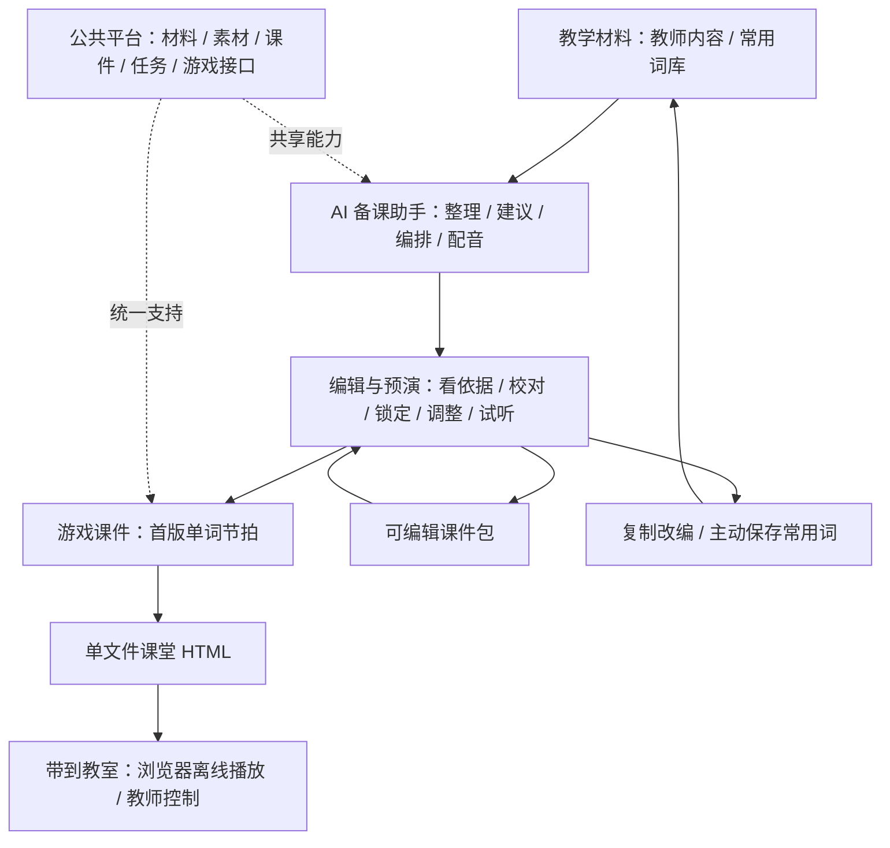

# english-class-games 详细设计 · 总览

> 版本：V1.0 最终设计基线 · 作者：ahui · 日期：2026-10-20

## 1. 产品与交付

**面向高中英语教师的 AI 赋能课堂游戏平台：以智能备课为核心、以小游戏为课堂载体，帮助教师整理材料、制作课件、编辑改编和检查成品，在家准备，带到教室直接使用。**

本项目的 AI 赋能定位为**知识与规则驱动的智能辅助**：采用本地词库、明确规则、模板组合、自动编排和系统语音合成，无需训练或部署大模型。教师看到的是有依据的候选、一键成稿、局部改编和问题定位；结果可解释、可修改、可复现，不依赖云端服务或 API 密钥。

设计以教师拿到的实际成果衡量 AI 赋能：减少重复整理、编排、配音和检查操作。各页面围绕同一份材料和课件接续工作；材料进入候选，确认内容形成课件，编辑保留人工决定，检查通过后携带固定成果上课。

**首版主能力：确认教学材料后，一键制作包含单词示范、开场 / 收尾口号和节奏安排的完整课件，编辑检查后导出可携带的课堂文件。** 材料复用、局部改编和资源修复均围绕这一成果；智能能力由平台共用，不局限于单词节拍或某个 AI 页面。

| 项目     | 首版规格                                                                            |
| -------- | ----------------------------------------------------------------------------------- |
| 适用人群 | 高中英语教师；教师组织全班活动                                                      |
| 系统     | Windows 10 22H2 / Windows 11，x64；备课软件需安装，课堂播放器使用 Edge / Chrome     |
| 首个游戏 | 单词节拍：单词喊麦 / 节奏跟读；不包含第二个游戏                                     |
| 教学内容 | 教师词表、表格和阅读文本为主，本地高中词库辅助                                      |
| 课堂控制 | 新课默认自动推进，开始后按预设连续示范、跟读、转场和切词直至完成；可选逐词等待教师  |
| 日常携带 | 只带一个离线 HTML 文件，内含播放器、课件及已启用的声音 / 音乐；教室无需安装备课软件 |
| 换机编辑 | `.ecglesson` 可编辑课件包，在安装备课软件的电脑使用                                 |
| 数据     | 本地保存，无账号、云同步、学生录音、发音评分或个人画像                              |

## 2. 系统组成与使用流程

默认路径：**打开 AI 工作台 → 导入或复用教学材料 → 确认词条与词义 → 选择练习预设 → 一键制作 → 编辑试听 → 导出并打开成品检查 → 带到教室测试声音后上课。**

智能辅助在各环节的落点如下，页面结构与操作细节由 02 定义。

| 使用环节 | 智能辅助的实际成果                       | 教师保留的控制                       |
| -------- | ---------------------------------------- | ------------------------------------ |
| 材料整理 | 有原文位置的候选、疑似重复、词义与来源   | 选哪些词、采用哪个义项、保留哪些重复 |
| 一键制作 | 预设编排、分段、口号、配音与真实编排时长 | 确认参数、试听、接受时间建议         |
| 编辑改编 | 受影响项提示、局部重做、换一版与前后差异 | 手改、锁定、应用或忽略、整次撤销     |
| 课件复用 | 独立副本、换材料差异、可复用声音         | 保留原课、选择替换范围               |
| 检查交付 | 缺损定位、资源检查、固定版本与成品结果   | 修复或明确调整模式、打开实际文件检查 |
| 课堂使用 | 已确认的词序、声音与节奏提示自动同步运行 | 暂停、重读、调速、切换推进方式与结束 |

例如，教师从本周高中阅读材料中选定 `knowledge` 和重点短语 `take part in`，确认本课词义后选择“常规巩固”。新建时所有词初始一轮；教师主动应用常规巩固预设后，安排普通词 2 轮、重点词 3 轮，为短语多留 1 拍跟读空间，并按实际配音长度计算安排；教师可调整、锁定，再带着导出的 HTML 到教室使用。这个过程的智能价值是减少整理、编排和检查操作，不需要输入提示词。界面的目标时长与编排时长均不含教师等待和暂停，实际课堂用时另计。

AI 助手是主要制作入口；手工编辑始终可用。首次离线启动即可使用内置词库、规则和口号模板，配音前检查本机实际可用的语音。缺少音色时明确修复或选择文字领读，不冒充制作成功。

智能成果统一回答“发现了什么、依据是什么、会改哪里、教师能怎样处理”：词义标来源，编排标规则，建议看前后差异，检查直达问题位置。课堂默认自动执行已经确认的词序、轮数和间隔，开始后无需手动下一词；可选逐词模式在非末词结束后等待教师。末词直接收尾，不根据学生声音推进。已有课件与主动保存的新课偏好保留原模式。

## 3. 文档分工

本组文档共同构成首版开发、复核与验收依据，定义最终范围与行为。每项规则只在所属文档定义，其他文档通过链接引用；修改业务规则时，同步修改对应验收项。

| 文档                                                | 唯一负责的内容                                           |
| --------------------------------------------------- | -------------------------------------------------------- |
| [01 · AI 赋能与教学规则](01-AI赋能与教学规则.md)    | 内容来源、智能能力、推荐依据、预设默认值、锁定与改编规则 |
| [02 · 页面交互与视觉规范](02-页面交互与视觉规范.md) | 页面结构、操作路径、配色、字号、布局、组件与反馈状态     |
| [03 · 课堂运行与便携交付](03-课堂运行与便携交付.md) | 节奏计算、教师控制、声音、离线 HTML、可编辑包与异常恢复  |
| [04 · 技术架构与数据规范](04-技术架构与数据规范.md) | 技术栈、职责、游戏接口、数据、任务、资源与版本兼容       |
| [05 · 开发复核与验收](05-开发复核与验收.md)         | 功能与视觉验收、固定案例、测试范围、交付要求             |

“AI”表示本地智能辅助；“静态预览”只展示编辑画面，“预演”实际运行课件；“文字领读”由教师示范、系统按编排留出跟读时间；“课堂文件”指可独立播放的 HTML，“可编辑包”用于继续备课。“可上课”始终指当前课件版本已通过当前声音模式的完整检查。

“修订”是某次保存形成的版本，“快照”是固定版本的内容副本；“素材”指课件使用的配音、录音和音乐文件。“依赖”指影响某项结果的内容或设置，例如英文影响对应配音，BPM 影响节奏安排。课堂与导出固定使用一个版本，避免编辑中的新旧内容混用。

“检查通过”表示当前版本的内容格式、编排和启用资源符合运行要求；教学词义、具体读音和练习强度仍由教师校对。课堂只执行已确认成果，AI 助手不在上课途中自行改词、重排或重新配音。

全系统采用**深墨蓝游戏控制台：深蓝底青色亮边主行动、青色智能辅助、长短角厚底组件**。备课区与课堂共用这套视觉：工作台用全息编排核心展示材料、声音与节奏的制作关系；课堂开始页用左右分区、能量装置和真实课件词卡建立关卡感。运行时中央大词、顶部词序、完成进度与四色立体拍垫构成主画面，星尘连线、拖尾、透视网格、光束和真实击拍爆发构成空间与反馈。AI 感来自本地智能制作能力及其可见成果，不伪造语音识别、学生分数或推理进度。

新课默认节奏方块，真实准备拍位显示 3 / 2 / 1 / GO；开始一次后自动执行整课。开始页允许低速氛围，运行效果响应真实拍序；暂停、等待、后台、特效关闭或系统减少动态效果时停止装饰运动，编辑器预览保持静态。桌面与离线 HTML 共用同一舞台，不增加网络或大模型依赖。

阅读顺序：先看本总览，再按职责查阅 01～04；开发完成后按 05 的编号逐项复核。字段、尺寸与操作行为以所属文档为准。

算法与数据时长统一用毫秒；界面可转换为秒 / 分钟并注明单位。文件大小 MB 按 1,000,000 字节、界面尺寸用 CSS 像素；详细字段单位以技术规范为准。

## 4. 架构原则

- 核心技术采用 **Tauri 2 + Rust + React 18 + TypeScript + SQLite** 分层，具体职责见技术文档。
- 多游戏共用材料、声音、任务、编辑外壳和导出能力；各游戏独立提供编排、配置、场景与结果，平台不按游戏名称添加例外分支。
- 桌面预演和离线课堂共用游戏运行核心，只有素材获取和本地服务的适配层不同。
- 教师内容优先；智能操作可预览、可撤销，不静默删词、覆盖手工修改或替换旧版本。
- 课堂使用与家中电脑、系统音色和网络解耦；软件升级不改写已经导出的课堂文件。

## 5. 技术与数据依据

- 词库基础：[ECDICT 数据说明](https://github.com/skywind3000/ECDICT/blob/bc015ed2e24a7abef49fc6dbbb7fe32c1dadaf8b/README.md)、[MIT 许可](https://github.com/skywind3000/ECDICT/blob/bc015ed2e24a7abef49fc6dbbb7fe32c1dadaf8b/LICENSE)。以高考标签 `gk` 筛选，再校对词义、词性和常用短语；分发保留版本与归属，不宣称官方教材匹配。
- 系统语音：[Windows SpeechSynthesizer](https://learn.microsoft.com/en-us/uwp/api/windows.media.speechsynthesis.speechsynthesizer?view=winrt-26100)。只使用接口实际列出的本地音色。
- 桌面运行环境：[Tauri Windows Installer / WebView2](https://v2.tauri.app/distribute/windows-installer/)。安装包包含 WebView2 离线安装资源；不把其存在作为课堂 HTML 的前提。
